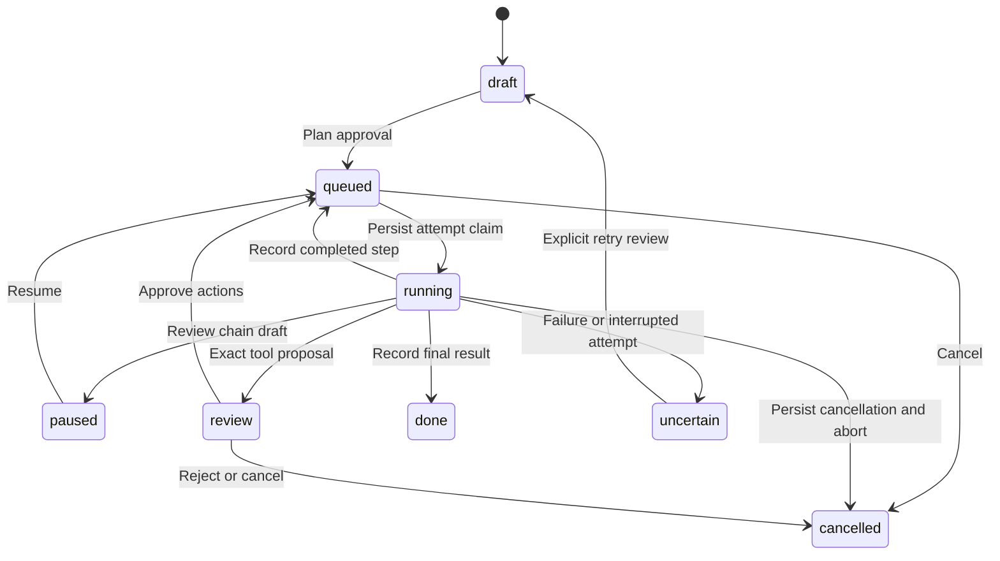

# Pro Studio

Current release: **11.0.0**.

Studio connects existing provider capabilities into reviewed, durable workflows. Start with `/workspace`, `/inbox` or `/autopilot goal`. It uses the same private-chat allowlist, OpenAI account, operator estimates and owner/project quotas as the rest of the bot. Model work and external actions require their explicit plan/action approvals. See the current Suite and provider guides for dependencies and setup.

## Seven delivered workflows

| Workflow                   | Entry point                                                     | Result and confirmation                                                                                                                       |
| -------------------------- | --------------------------------------------------------------- | --------------------------------------------------------------------------------------------------------------------------------------------- |
| Task autopilot             | `/autopilot Prepare a sales report`                             | An inspectable three-step recipe: inspect/calculate, prepare, review/finalize. Approve the plan and estimate before worker execution.         |
| Unified Inbox              | `/inbox on`, then send/forward content                          | Capture text, links, photos, documents and recording metadata without generation/transcription. Review and process selected items explicitly. |
| Source-backed research     | `/investigate question`                                         | Public evidence search, a separate counter-evidence search, then a source-backed brief with contradictions and uncertainty.                   |
| Working Mini App           | `/workspace`                                                    | Browse conversations, projects, project files, Inbox, tasks, missions, results, job states and estimated usage.                               |
| Cross-service chains       | `/chain mail \| Draft an email ;; calendar \| Prepare an event` | Draft first, pause for local review/edit, resume to propose service actions; each concrete MCP action requires separate Telegram approval.    |
| Restart-safe orchestration | `/missions`, `/mission ID`                                      | Persisted stage claims, completed checkpoints, outcome-unknown states and receipts; no automatic paid replay.                                 |
| Versioned results          | `/result ID`                                                    | Download artifacts; edit text/passages, compare versions, restore a previous selection or propose a paid revision.                            |

`/research` remains the older single-job command; `/investigate` is the new multi-stage research recipe. Studio recipes are deterministic and inspectable, not an unrestricted model-generated execution plan. The model performs the reviewed stages. It cannot silently add service steps, approve tools or execute code on the bot host.

## Plan, execute and inspect

1. Choose the conversation/project and attach or reply to relevant files. `/autopilot goal` snapshots up to ten selected/retained files and images using the existing input collector. Supported data files select the Code Interpreter inspection stage; other material uses the normal model adapter. Material names and counts appear in the preview.
2. Inspect the step instructions and configured remaining estimate. `/mission context ID` downloads the exact frozen `JobInput`, including encoded attachments and preferences. Protect this private file. Saved long-term notes are not stored in mission inputs; selected project/conversation instructions and glossary/language preferences can be included explicitly.
3. Before approval, change a step with `/mission edit ID N | replacement instructions`. A draft expires after ten minutes; editing a queued draft step refreshes that review window. Approve through the plan button or the Mini App review.
4. The worker attempts at most one queued step per owner per tick, sharing foreground/background/live capacity and session locks. Each claim is persisted before the provider call. Estimates are revalidated before spending; a changed operator estimate requires a fresh plan. Quotas are reserved per attempted step, not prepaid for the entire plan, so a later step can stop at a quota limit. Conversation model preference is resolved at execution; file/project context remains frozen. The origin conversation and selected project must still match.
5. Inspect `/mission ID` for stage state, attempt count, receipts and exact pending external arguments. `/mission step ID N` retrieves a completed step's full retained text, sources and files. `/mission pause ID` pauses between stages; `/mission resume ID` resumes already-reviewed work. `/mission cancel ID` cancels pending work or signals an active attempt. Cancellation remains available even when request capacity is exhausted. Already-started provider work can still be billed.

Milestone notifications announce completed, paused, review-required or uncertain missions. Their revision is claimed before transport; ambiguous acknowledgement is not automatically retried. Quiet/digest windows suppress these Studio milestone notices rather than adding a new digest item. Inspect missions in Telegram or refresh the Mini App at any time. Existing job/task digest behavior is unchanged. Large results are retrieved with `/result ID` or downloaded explicitly rather than pushed repeatedly.

## Inbox without accidental processing

`/inbox on` enables capture in the selected conversation. `/inbox off` restores normal chat behavior. Text and URL capture does not fetch pages; recording capture stores Telegram metadata, without downloading or transcribing audio. Images/documents use the existing bounded Telegram download adapters. Forwarded slash commands stay content while Inbox capture is on. Repeated delivery of the same Telegram message is deduplicated by source message ID.

```text
/inbox
/inbox save Keep these notes
/inbox view ITEM_ID
/inbox assign ITEM_ID PROJECT_ID
/inbox assign ITEM_ID none
/inbox plan ITEM_ID
/inbox process
/inbox process FIRST_ID,SECOND_ID
/inbox task ITEM_ID
/inbox meeting ITEM_ID
/inbox delete ITEM_ID
```

Explicit saves can use replied text, documents or recording metadata. Item type and project suggestion are local metadata: the project is the captured selection, not an AI classification. Assigning changes that suggestion without moving or executing anything. Processing and task/meeting proposals require the source conversation and assigned project to be selected.

`plan` prepares an autopilot review for one item; standalone HTTPS links select the public research recipe. `process` snapshots one to ten non-recording items from the current conversation/project into one reviewed summary/next-step mission. Text is quoted as untrusted content. File/count/input/storage limits still apply, and original Inbox items remain until explicitly deleted. Process recordings separately with `meeting`: the existing transcription/protocol cost review and separate task confirmation are reused. `task` proposes the item's text as a local task with no invented deadline; creation requires the existing expiring task-review confirmation.

## Research evidence boundaries

Research sends only the explicit public question and subsequent public search results; private files, images, saved notes and project instructions are excluded. Owner/project quota accounting remains local. Search stages require safe source links returned by the adapter; an answer with no usable sources stops as uncertain rather than being called verified. The final result preserves a bounded deduplicated source list and clickable links in Telegram and the Mini App.

The two search prompts request primary/independent sources, dates, counter-evidence and missing support. Their claim assessments are model-generated, not independent factual certification. The bot cannot guarantee publisher independence, factual correctness, complete source coverage or access to a paywalled/deleted page. Inspect citations and the reported uncertainty. This workflow uses ordinary Responses web search, not a separately qualified deep-research service. Public search and private MCP operations are never combined in one model request.

## Chains: draft, review, act, receipt

Configure authenticated owner-scoped remote MCP services as described in [the provider guide](pro-provider.md). Service names in `/chain` must match `/connections`; each of one to four service requests has at most 2000 instruction characters. The first compose step prepares drafts from the reviewed material. It then **pauses**, retaining an editable draft version. Use `/result edit ID | corrected draft` or the Mini App editor, inspect it, then `/mission resume ID`.

The selected draft replaces the original draft in subsequent service context. Prior service responses can also reach later services; review this cross-service data flow before approving the plan. Binary files are not attached to MCP steps, but draft/result text can contain sensitive material. Each provider tool uses the existing `require_approval: always` adapter. Review exact tool names, recipients, dates, bodies and other JSON arguments in Telegram. Approval is revision/owner/conversation bound, expires after ten minutes before acceptance, and is consumed before continuation. Browser actions cannot approve external tools or perform an uncertain paid retry.

Successful responses produce per-step reported-result receipts; approved/rejected arguments are retained in bounded event history. A receipt records the provider's report, not independently verified external success. Connection configuration signatures still reject destination/account changes during a pending continuation. Repeated proposals require repeated reviews; the event history is bounded at 20 entries. Unknown failures require inspecting the service before any explicit retry. The bot does not implement distributed transactions or automatic compensating service actions.

## Recovery and uncertain outcomes

Run one bot process against a state file. This is single-writer local orchestration, not a distributed worker lease protocol. On restart:

- Completed steps and their results stay complete.
- Queued unattempted steps can continue under their recorded plan approval and current quotas.
- A persisted running step becomes `uncertain`; approval continuations are cleared. No paid attempt is automatically replayed.
- Explicitly cancelled missions remain cancelled, including when cancellation happened during an in-flight call.



For an uncertain step, check the recorded receipts and external service/provider state. `/mission retry ID confirm` creates a fresh draft and estimate review for that step while preserving completed checkpoints. An expired pending tool review can also be explicitly reset this way. Retrying can incur another charge and propose duplicate external effects; new exact tool approvals remain mandatory. There is no claim of provider-side exactly-once execution.

Storage writes happen before effects and before publishing completed state. If persisting a result fails after the provider responded, the outcome remains uncertain rather than being silently rerun. Provider resources use the existing cleanup journal/expiry controls; Studio does not make remote calls atomic with local state. `/mission delete ID` removes a non-running mission and its retained versions; cancel active work first.

## Results and revisions

```text
/result MISSION_ID
/result export MISSION_ID
/result edit MISSION_ID | replacement text
/result replace MISSION_ID | exact unique passage | replacement
/result compare MISSION_ID | FIRST_VERSION_ID | SECOND_VERSION_ID
/result restore MISSION_ID VERSION_ID
/result revise MISSION_ID | improve the conclusion
```

Completed results and paused action drafts support local text edits and version selection without a model call. Replacing a passage requires one exact unique match, avoiding an accidental global replacement. Each edit adds a version with stable parentage. Restore changes the selected version while retaining history. Comparison exports the changed line block as a `.diff` file; it is not a semantic fact checker.

A paid revision requires a completed mission and a new plan/estimate approval. Data-analysis missions use Code Interpreter again for revisions; other recipes use a compose revision. Generated artifacts flow to subsequent results, with the latest file of a given name selected. Older files remain with their old versions. Text-only edits retain attached files and source metadata; editing prose does not recalculate files or establish support for new claims. Use a paid revision when recalculation is needed.

The Mini App preserves unsaved text in page memory across refreshes and submits its original revision to reject stale edits. It does not write drafts into browser storage. Closing the page discards unsaved edits; saved versions remain in private state. Downloads require signed owner authorization and a retained mission/version/file match, or ownership of a project file.

## Limits, state and lifecycle

| Resource                                      | Limit                                                                                           |
| --------------------------------------------- | ----------------------------------------------------------------------------------------------- |
| Inbox                                         | 100 items per owner                                                                             |
| Missions                                      | 20 retained missions per owner                                                                  |
| Initial recipe                                | 3 autopilot/research stages; a draft plus 1..4 services for chains                              |
| Revisions                                     | At most 10 total steps and 10 result versions per mission                                       |
| Step edits/service instructions               | 1..2000 characters                                                                              |
| Model result/manual version text              | 1..60000 characters                                                                             |
| Shared setting for each owner's Studio record | `MAX_JOB_BYTES`, default 20 MB, maximum 64 MB; independent from the older queue's record budget |
| Attachments                                   | Existing per-file/encoded memory limits, up to 10 documents and 10 images in a mission          |
| Plan/tool/task review                         | Ten minutes before acceptance; stale revisions are rejected                                     |

Inputs, intermediate outputs, versions, Inbox media and tool continuations can contain private information. Studio has no automatic content TTL: delete individual items/missions or use `/erase confirm`. `/reset` and conversation deletion disable capture and cancel pending missions for that conversation; they retain independent Inbox items and completed Studio results. Project deletion cancels unfinished missions for that project. Erasure aborts active Studio work and removes the `studio` scope; the existing minimal quota/remote-cleanup retention rules still apply.

`/data` includes private Studio state in extensions. Canonical archive import intentionally does **not** restore source Studio capture settings, plans, external approvals, recordings or version IDs; destination Studio content remains authoritative. Use exported Markdown/files or explicit re-addition for content transfer. Schema remains 3 and archive format remains 2 because Studio is a new scoped JSON record. Back up before upgrading; older versions ignore these records and cannot recover their pending workflows. Cancel unfinished missions before rolling back.

## Mini App setup and qualification

The workspace shares `MINI_APP_URL`, port and signed Telegram authorization with live voice. Rebuild with `npm run build` before enabling/updating it. `/workspace` opens `MINI_APP_URL/workspace/`; proxy that path and the shared static/API children to the loopback server as described in [provider setup](pro-provider.md). The server never sends the OpenAI key or MCP authorization to the browser. Reopen from the bot when the short-lived Telegram authorization expires. The working interface is English, uses text-only content rendering, accessible controls, responsive lists, one accent color and reduced-motion support.

Qualification is **unit/static only**: fake provider/fetch/server/media/DOM ports, a controlled in-memory state store, checkpoint-write failures, cancellation/restart races, owner/revision/approval boundaries, source filtering, version operations, HTTP authentication and browser-state races. No real browser, microphone, SQLite/native decoder, application server, external service or paid API is exercised. Build output and unit coverage do not establish HTTPS deployment, visual/native browser interoperability, account/model/tool availability or external-effect correctness.

API references: [Responses web search](https://developers.openai.com/api/docs/guides/tools-web-search), [MCP approvals](https://developers.openai.com/api/docs/guides/tools-connectors-mcp). Existing adapter and provider limits remain described in [Pro provider workbench](pro-provider.md).
